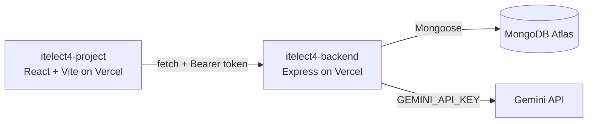

# itelect4-project

[](https://github.com/cus08/itelect4-project/actions/workflows/ci.yml)

A React + Vite tutoring and course submission platform connecting peer tutors with tutees for academic guidance, session scheduling, booking management, and AI project reviews.

- **Frontend repo:** https://github.com/cus08/itelect4-project
- **Backend repo:** https://github.com/cus08/itelect4-backend
- **Live Frontend:** https://itelect4-project.vercel.app
- **Live API:** https://itelect4-backend.vercel.app/api/health

---

## 🏛️ Architecture



---

## 📌 Project Features
- **Authentication**: JWT-based login and registration with Zod schema validation.
- **Sessions & Bookings**: Browse peer tutoring sessions, request bookings, and manage statuses.
- **Submissions**: Submit course repositories with grade indicators and submission badges.
- **AI Reviews**: Integrated Gemini AI review to provide feedback on project descriptions.
- **Automated Testing**: Comprehensive unit, component, and integration tests with Vitest and React Testing Library.

---

## 🛠️ How to Run Locally

### 1. Install Dependencies
```bash
npm install
```

### 2. Configure Environment
Copy `.env.example` to `.env`:
```bash
VITE_API_URL=http://localhost:4000
```

### 3. Run Development Server
```bash
npm run dev
```

### 4. Run Tests
```bash
npm test
```

### 5. Run Linter & Build
```bash
npm run lint
npm run build
```

---

## 🤖 AI-Use Disclosure
GitHub Copilot and Google Antigravity were used to assist in writing test specifications, boilerplate configuration, and code documentation under student supervision.
